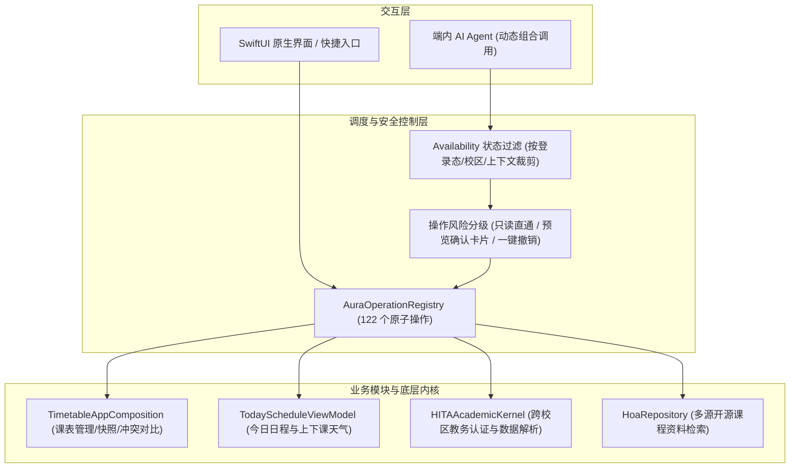

# HITA Aura

**学生自研的面向哈尔滨工业大学一校三区的 iOS 原生 AI-Native 校园日程助手**

[产品官网](https://hita.strayrn.com) · [App Store 下载](https://apps.apple.com/cn/app/hita-aura/id6760897635) · [提交 Bug / 功能建议](../../issues)

---

## 关于本仓库

本仓库为 **HITA Aura** 的公开文档与用户反馈（Issues）仓库。

由于客户端内包含学校教务接口与登录配置，主工程目前保持闭源。本仓库整理了应用的基础功能、核心设计思路、技术架构和运行数据；如果你在使用中遇到任何问题，或者有新功能想法，欢迎直接在 [Issues](../../issues) 中提出，也欢迎加入我们的测试QQ群：1093659013。

---

## 功能概览

App 围绕 **“今日 — 时间表 — 工作台 — 资讯 - 资源”** 五个底部页面与右上角**我的**头像页展开：

- **今日**：
  1. 进行问候并展示正在进行的课程状态
  2. 紧凑展示今日课程、校区天气，以及资讯、考试、作业、资源、Agent等小组件。

- **时间表**：

  1. 宏观展示当周课表。左右滑动切周，下拉切换学期以及ICS导入的其他课表，长按进入课表编辑态，可拖动移动位置、调整课程长度或者点击课程胶囊进入更详细编辑页面。
  2. 详情页内容丰富。在课程名、时间、地点、课程代码之外加入课程闹钟、课次天气等功能，并与资源板块联动，点击课程代码或查看更多内的对应条目可直达对应资源页。
  3. 进行课表对比。点击星期栏进入课表对比模式，可选择一个或多个导入的其他课表进行日程对比。
  4. 个性化小功能。通过顶部tool可选择是否显示课程标题、上课地点、考试、关注课程、已结束课程彩色显示，并可选择一键生成当周课表整页截图。

- **工作台**：
  1. 模块化设计，无需点击即可获取最要紧信息，接入学分情况、考试安排、空教室集中查询、选课预览、全校课表、成绩、导入课表、课程闹钟管理等功能。
  2. 学分情况：对深圳校区网页登录，支持显示创新创业、跨专业、文理通识学分达成情况一览，并可点击进入详细信息显示。
  3. 空教室：可从工作台页直接点选楼栋进行查询，也可在页面内进行更为精细的逐日逐楼栋逐课次空教室情况统计。
  4. 选课预览：接入选课信息（但不上传内容）用于选课规划。可自由选择待选课，选择后其他课程会自动标注冲突课程，并且可以预览选择成功后的课表情况。
  5. 全校课表：可查询全校所有开课，可设置关注，关注课程可显示在时间表中。

- **资讯**（仅登录对应校区后显示）：
  1. 接入对应校区校园通知，并可应用内访问。
  2. 接入校园内学生博客，现仅加入深圳校区博客。
     
- **资源**：
  1. 默认对时间表内课程进行卡片化展示，点击直达对应课程资料。
  2. 聚合 **HOA（哈工深开源课程资料库）**、**HITCS**、**薪火笔记社** 课程资料，支持课程代码、课程名、课程老师检索。
  3. 支持原生渲染课程 `README` Markdown、浏览仓库目录、查看 PR 历史与应用内投稿。

- **我的**：
  1. 支持个人信息管理，如昵称与头像设置、账号切换、静默登录开关等。
  2. 个性化设置，如应用内自定义墙纸（Pro）、小组件壁纸（Pro）、应用图标切换。
  3. 通知与智能设置，如课程提醒与Agent设置。
  4. 清理应用数据，回归初始态。
  5. HITA Aura Pro管理。

---

## 线上运行数据（截至 2026.11.1）

| 维度 | 核心数据 | 具体情况 |
| :--- | :--- | :--- |
| **下载与日活** | 累计下载 **1,070** / 峰值 **DAU 447** | 教学周工作日均 **DAU 389**，约占历史总下载量的 **41.8%** |
| **使用频次** | 3 个月累计打开 **108,175** 次 | 教学周工作日均打开 **2,500+ 次**，活跃用户日均打开 **6.4 – 7.1 次** |
| **稳定性** | **99.84%** 无崩溃会话率 | 过去 3 个月（10.8 万+ 次前台会话）累计发生崩溃 65 次 |
| **教务与资料查询** | **4,780+** 次课程资料查阅 | 聚合 HOA、HITCS、薪火笔记社开源资料；累计完成 **1,270+ 次**课表导入与 **7,500+ 次**成绩/考试/学分查询 |
| **Pro 买断** | **42** 笔 `HITA Aura Pro` | 核心功能全部免费；Pro 买断在活跃用户中的转化率约 **9.4%**，专属壁纸日均活跃 **16–21 人** |

---

## 核心设计与技术实现

### 1. 端内 Agent 架构：将 App 功能拆解为 122 个原子操作

HITA Aura 将 App 内的教务查询、课表增删改、空教室检索、资料查找和偏好设置等基本功能封装成了 **122 个强类型的原子操作（`AuraOperation`）**，统一注册在 `AuraOperationRegistry` 中。

SwiftUI 界面上的按钮点击和 AI Agent 的工具调用底层使用同一套接口：

- **动态组合长尾需求**：对于用户的诸如“看我周三下午哪节课后有空，在 T2 找个空教室，顺便打开下节课的复习资料”的跨页面需求，模型可凭借自身智能自行组织工作流。
- **修改操作二次确认与撤销**：涉及修改本地课表、写入系统日历等有副作用的操作，先弹出**确认卡片**征求用户确认，并支持一键撤销。

---

### 2. 课表同步与版本快照：解决教务系统“半夜吞实验课”的问题

对于学校教务长期存在的**部分实验课会在每天夜间从教务系统消失**的问题，结合同学实际存在的课表修改需求，采取以下措施解决：

- **冲突分栏对比**：课表刷新后发现远端发生变化时弹出分栏确认页，一边列出教务系统的变动明细，另一边列出本地修改细则（支持逐项勾选保留）。
- **类似 Git 的本地快照与回滚**：每次拉取远端更新或恢复旧课表前自动存一份本地快照，支持写备注和随时回滚。
- **直接拖拽编辑**：长按即可进入课表编辑模式，支持直接拖拽课程换位置，或者拉动课程卡片上下边缘调整节次时长。

---

### 3. 上下课天气提醒

HITA Aura的天气功能基于Apple Weatherkit，与校园日程紧密结合。

- 在今日页，克制显示当前时刻温度与天气，若在课程前后存在雨雪等特殊天气，会用小字在课程卡片下提示。
- 在课程详情，用图标显示该节课上课与下课时刻的天气情况。
- 点击任意来源的天气信息，进入详细天气sheet，可显示当日与未来十日详细情况，并结合时间轴与具体课表直观显示课程与天气的对应关系。

---

### 4. 原生体验与其他亮点

- **原生 Swift/SwiftUI 开发**：尽可能减少自定义组件的使用，充分利用 Apple 提供的原生API实现优质的动画与交互。
- **Apple 生态组件打通**：
  - `WidgetKit` + `ActivityKit`：提供桌面/锁屏小组件与上课实时活动（灵动岛），通过 App Groups 共享课表快照并支持点击跳回对应页面。
  - `MapKit`：内置哈工大（深圳）3D 校园地图，做了远、中、近三级视距的建筑标签聚合，支持从今日课表一键高亮下一节课的教学楼（如 `T2`）。
  - 完整接入 `WeatherKit`、`EventKit`（系统日历同步）、`AlarmKit` 与 `StoreKit 2`。
- **时间天气联动**
  - 四套默认壁纸均支持随着时间与天气进行细节调节，字体颜色也会随时间与天气发生改变。
    
---

## 问题反馈与联系

- 遇到 Bug 或有新功能建议，欢迎提交 [New Issue](../../issues/new)并加入我们的测试QQ群（1093659013）进行详细反馈。
- 个人主页：[strayrn.com](https://strayrn.com) · 邮箱：`strayrn@outlook.com`
